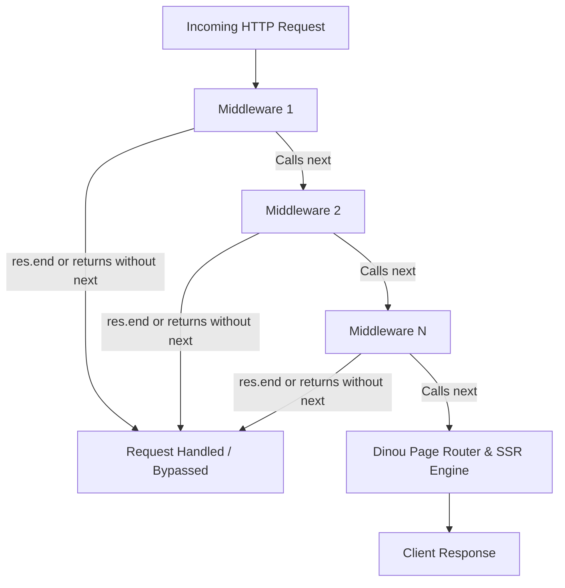

# Dinou v7 Core Enhancements & Knowledge Transfer

This document serves as a comprehensive knowledge transfer guide detailing the architectural enhancements made to the **Dinou v7 core** and CLI. These features enable complex production applications (such as WebSockets with Redis, custom HTTP middlewares, JWT authenticated Server Functions, and standalone compiled Docker containers) to run completely **without ejecting** the framework.

Use this reference when updating the official documentation in `dinou-docs`.

---

## Table of Contents
1. [Plugin Hook: `configureServer`](#1-plugin-hook-configureserver)
2. [CLI & Standalone Binary Compilation: `build:node:compile`](#2-cli--standalone-binary-compilation-buildnodecompile)
3. [Client-Side Server Function Hooks: Auth & Custom Headers](#3-client-side-server-function-hooks-auth--custom-headers)
4. [Request Context Sharing with Server Functions](#4-request-context-sharing-with-server-functions)
5. [Esbuild-Powered Config Bundling & Removal of Legacy Babel Loader](#5-esbuild-powered-config-bundling--removal-of-legacy-babel-loader)
6. [Complete Dinou CLI Scripts Reference (`package.json`)](#6-complete-dinou-cli-scripts-reference-packagejson)
7. [Documentation Checklist for `dinou-docs`](#7-documentation-checklist-for-dinou-docs)

---

## 1. Plugin Hook: `configureServer`

### 1.1. Motivation & Background
Prior to Dinou v7, applications running on Node.js had no official hook to access or modify the underlying Node.js HTTP/HTTPS server instance before `server.listen()`. 

Whenever developers needed to:
- Attach WebSocket servers (`socket.io`, `ws`, `uWebSockets.js`),
- Prevent Dinou's SSR/page router from returning `404 Not Found` for internal HTTP polling paths (like `/socket.io/?...`),
- Integrate battle-tested Connect/Express middlewares (`cors`, `helmet`, `express-rate-limit`, `compression`),
- Handle raw streaming payloads before any body parser touched them,

they were forced to **eject** from Dinou, losing framework auto-updates and out-of-the-box build optimizations.

The `configureServer` plugin hook solves this problem entirely. It allows developers to configure the HTTP server and register low-level Node middlewares directly in `dinou.config.mjs`, running identically in both **Development** (`dinou dev`) and **Production** (`dinou start:node` / standalone compiled binaries).

---

### 1.2. Hook Parameters: `{ server, isDev, use }`

The hook receives a single context object containing three properties:

```typescript
export interface ServerHookContext {
  /** The native Node.js HTTP/HTTPS server instance */
  server: HttpServer;
  /** Boolean indicating whether the server is running in development mode */
  isDev: boolean;
  /** Function to register Node.js request-level middlewares before Dinou handlers */
  use: (middleware: NodeMiddleware) => void;
}
```

#### 1. `server` (`http.Server` / `https.Server`)
The actual Node.js HTTP server instance instantiated by Dinou.
- **Capabilities**:
  - Bind WebSocket engines: `new SocketIOServer(server)` or `new WebSocketServer({ server })`.
  - Listen to native server events: `server.on("upgrade", ...)`, `server.on("error", ...)`, `server.on("close", ...)`.
  - Configure low-level socket timeouts: `server.timeout = 30000;`, `server.keepAliveTimeout = 5000;`.

#### 2. `isDev` (`boolean`)
A boolean flag indicating the current running environment:
- `true` when running via `dinou dev`.
- `false` in production (`dinou start`, `dinou start:node`, or when running the standalone compiled binary).
- **Capabilities**:
  - Toggle verbose debugging logs or performance profilers only in development.
  - Enable development-only mock services, local proxies, or inspect tools.
  - Apply stricter security headers or SSL enforcement only when `!isDev`.

#### 3. `use` (`(middleware: NodeMiddleware) => void`)
A registration function for **low-level Node.js HTTP middlewares** (following the standard Connect/Express middleware pattern).

---

### 1.3. Deep Dive: What is `use` and How Does It Work?

`use` accepts a middleware function with the classic signature:
```typescript
type NodeMiddleware = (
  req: http.IncomingMessage,
  res: http.ServerResponse,
  next: () => void
) => void | Promise<void>;
```

#### The Internal Middleware Pipeline
When Dinou boots, all middlewares registered via `use(...)` are pushed to an internal array `nodeMiddlewares`. 

Whenever an incoming HTTP request hits the Node server:
1. Dinou passes the raw `req` (`http.IncomingMessage`) and `res` (`http.ServerResponse`) through each middleware in the order they were registered.
2. The middleware has three options:
   - **Call `next()`**: Hand off control to the next middleware in line, and ultimately to Dinou's routing and SSR engine.
   - **Omit calling `next()` (Short-circuit)**: If the middleware handles the request internally (e.g. an external library like Socket.IO), it simply returns without calling `next()`. Dinou halts processing and will **not** attempt to render a page or return a 404.
   - **Respond directly via `res.end()`**: The middleware can write headers and send a response directly (e.g. for `/healthz` or `/metrics`). Dinou detects `res.writableEnded || res.headersSent` and immediately stops the pipeline.



---

### 1.4. Key Real-World Use Cases for `configureServer` & `use`

#### Case 1: WebSocket HTTP Polling Interception (e.g. Socket.IO)
Socket.IO does not only communicate via WebSocket upgrades; its handshake and fallback transport use HTTP long-polling to paths like `/socket.io/?EIO=4&transport=polling...`. 
Without `use`, Dinou's file-based router would treat `/socket.io` as an unknown page route and return a `404 Not Found` HTML page, breaking the connection.

```javascript
// Intercept Socket.IO polling requests so Dinou doesn't return 404
use((req, res, next) => {
  if (req.url && (req.url === "/socket.io" || req.url.startsWith("/socket.io/"))) {
    return; // Socket.IO's internal listeners on `server` handle this; bypass Dinou!
  }
  next();
});
```

#### Case 2: High-Performance Health Checks & Kubernetes Probes
In cloud environments (Kubernetes, DigitalOcean App Platform, AWS ECS), load balancers send health probes (e.g. `/healthz` or `/live`) every 5–10 seconds. Executing full React SSR or framework routing for every probe wastes CPU. With `use`, health checks respond in sub-milliseconds:

```javascript
use((req, res, next) => {
  if (req.url === "/healthz") {
    res.writeHead(200, { "Content-Type": "text/plain" });
    res.end("OK");
    return; // Do not call next()
  }
  next();
});
```

#### Case 3: Integrating Battle-Tested Express / Connect Middlewares
You can directly plug in standard npm middlewares such as `cors`, `helmet`, or `compression`:

```javascript
import cors from "cors";
import helmet from "helmet";

export default {
  plugins: [
    {
      name: "security-middlewares",
      configureServer({ use, isDev }) {
        // Apply CORS
        use(cors({ origin: isDev ? "*" : "https://myapp.com" }));

        // Apply Security Headers
        use(helmet({ contentSecurityPolicy: false }));
      },
    },
  ],
};
```

#### Case 4: Raw Body Handling for Cryptographic Webhooks
Payment gateways like Stripe or webhooks from GitHub require inspecting the exact raw binary buffer of the request body to verify HMAC signatures before any JSON body parser mutates or parses it:

```javascript
use(async (req, res, next) => {
  if (req.url === "/raw-webhook" && req.method === "POST") {
    const chunks = [];
    for await (const chunk of req) {
      chunks.push(chunk);
    }
    req.rawBody = Buffer.concat(chunks);
  }
  next();
});
```

#### Case 5: Prometheus Metrics or Custom Telemetry
Expose a `/metrics` endpoint for Prometheus scraping without creating a dedicated Dinou page route:

```javascript
use((req, res, next) => {
  if (req.url === "/metrics") {
    res.writeHead(200, { "Content-Type": "text/plain" });
    res.end(getPrometheusMetricsString());
    return;
  }
  next();
});
```

---

### 1.5. Architectural Comparison: `configureServer({ use })` vs `onRequest(request, context)`

Dinou plugins offer two different request interceptors. Knowing which one to use is critical:

| Feature | `configureServer({ use })` | `onRequest(request, context)` |
| :--- | :--- | :--- |
| **Abstraction Level** | **Low-level Node.js**: `http.IncomingMessage` & `http.ServerResponse`. | **Web Standards (Fetch API)**: `Request` & `Response`. |
| **Execution Point** | At the very entry of the Node HTTP server, **before** Dinou constructs Web Standard objects. | Inside the Dinou request pipeline, **after** Node conversion but before route rendering. |
| **Control Flow** | Express/Connect style via `next()`, `res.writeHead()`, `res.end()`. | Web Standards: returns `Response` or `undefined` (to continue). |
| **WebSocket / Raw TCP** | **Yes**: Can bypass HTTP completely or inspect raw TCP socket. | **No**: Only handles standard HTTP request/response. |
| **Server Functions** | Can inject Node-level properties into `req`. | Can attach properties directly to `context` (accessible via `getContext()`). |
| **Best For** | WebSockets (Socket.IO/ws), raw body streams, `/healthz` bypass, Connect/Express middlewares. | Auth redirects, i18n language routing, modifying response headers, setting `context` for Server Functions. |

---

### 1.6. Complete End-to-End Example (`dinou.config.mjs`)

Here is how `configureServer` is used in a full production setup with Socket.IO, Valkey/Redis, and health probes:

```javascript
// dinou.config.mjs
import { Server as SocketIOServer } from "socket.io";
import { createClient } from "redis";
import { createAdapter } from "@socket.io/redis-adapter";
import { socketState } from "./src/socket-state.js";

export default {
  plugins: [
    {
      name: "node-server-enhancements",
      async configureServer({ server, isDev, use }) {
        // 1. Instant Health Check Endpoint (Sub-millisecond latency)
        use((req, res, next) => {
          if (req.url === "/healthz") {
            res.writeHead(200, { "Content-Type": "text/plain" });
            res.end("OK");
            return;
          }
          next();
        });

        // 2. Bypass Socket.IO HTTP Polling Requests from Dinou SSR
        use((req, res, next) => {
          if (req.url && (req.url === "/socket.io" || req.url.startsWith("/socket.io/"))) {
            return; // Socket.IO handles this directly
          }
          next();
        });

        // 3. Attach Socket.IO to the native Node HTTP Server
        const io = new SocketIOServer(server, {
          cors: { origin: isDev ? "*" : false },
        });

        // 4. Multi-Instance Horizontal Scaling with Redis/Valkey
        const redisUrl = process.env.VALKEY_URL || process.env.REDIS_URL;
        if (redisUrl) {
          try {
            const pubClient = createClient({ url: redisUrl });
            const subClient = pubClient.duplicate();
            await pubClient.connect();
            await subClient.connect();
            io.adapter(createAdapter(pubClient, subClient));
            console.log("✅ [Socket.IO] Redis adapter enabled.");
          } catch (err) {
            console.error("❌ [Socket.IO] Redis adapter connection failed:", err);
          }
        }

        // 5. Connect Socket Events & Expose to App State
        io.on("connection", (socket) => {
          const userId = socket.handshake.query.id;
          if (userId) socket.join(String(userId));
        });

        socketState.io = io;
      },
    },
  ],
};
```


---

## 2. CLI & Standalone Binary Compilation: `build:node:compile`

### Motivation
Dinou supports compiling to a single standalone executable binary using Bun's compiler (`bun build --compile`). Previously, the CLI only had commands for Bun-native servers (`build:bun:compile` / `build:bun:pure:compile`).
However, modern multi-container deployments (such as containerized Node apps utilizing native Node HTTP primitives, Redis, and WebSockets) require the **Node runtime entry** bundled and compiled into a single lightweight binary, eliminating the need to install `node_modules` or a full Node runtime inside minimal production containers.

### What Was Added
Added Node compilation commands and cross-compilation targets to `cli.js` and `eject.js`:

#### Command Reference

| Command | Description |
| :--- | :--- |
| `dinou build:node:compile` | Bundles with Esbuild and compiles `node-entry.mjs` into a standalone binary using Bun compile. |
| `dinou build:node:pure:compile` | Pure standalone compile without external dependencies. |
| `dinou build:node:compile:linux` | Cross-compiles standalone binary for Linux x64 (`--target=bun-linux-x64`). |
| `dinou build:node:compile:linux_arm` | Cross-compiles standalone binary for Linux ARM64 (`--target=bun-linux-arm64`). |
| `dinou build:node:compile:mac` | Cross-compiles standalone binary for macOS (`--target=bun-darwin-x64`). |
| `dinou build:node:compile:win` | Cross-compiles standalone binary for Windows (`--target=bun-windows-x64`). |
| `dinou build:node:pure:compile:linux` | Pure cross-compile for Linux x64. |
| `dinou build:node:pure:compile:linux_arm` | Pure cross-compile for Linux ARM64. |
| `dinou build:node:pure:compile:mac` | Pure cross-compile for macOS. |
| `dinou build:node:pure:compile:win` | Pure cross-compile for Windows. |

#### Dockerfile Example
```dockerfile
# Stage 1: Build & Compile
FROM oven/bun:1 AS builder
WORKDIR /app
COPY package.json bun.lockb* ./
RUN bun install --frozen-lockfile
COPY . .
RUN bun run build:node:pure:compile

# Stage 2: Minimal Distroless / Alpine Runner
FROM alpine:latest
WORKDIR /app
COPY --from=builder /app/dist/server /app/server
COPY --from=builder /app/public /app/public
EXPOSE 3000
CMD ["/app/server"]
```

---

## 3. Client-Side Server Function Hooks: Auth & Custom Headers

### Motivation
When calling a Server Function from a Client Component (e.g. `await myServerFunction()`), the browser executes `createServerFunctionProxy`, which issues a `POST /____server_function____` request.
Previously, only `"x-server-function-call": "1"` was sent in headers. If an application used JWTs or Bearer token authentication (validating `req.headers["authorization"]` on the server via wrappers like `withAuth`), developers had to eject Dinou to hardcode an `import { getAccessToken }` into `server-function-proxy.js`.

### What Was Added
In `dinou/core/server-function-proxy.js` and `dinou/core/server-function-proxy-webpack.js`, the proxy now checks for global client hooks on `window` before dispatching the fetch request:

1. `window.__DINOU_SERVER_FUNCTION_HEADERS__`: A callback function returning arbitrary custom headers.
2. `window.__DINOU_GET_AUTH_TOKEN__`: A callback function returning a bearer/access token string.

```javascript
// core/server-function-proxy.js
let customHeaders = {};
if (typeof window !== "undefined") {
  if (typeof window.__DINOU_SERVER_FUNCTION_HEADERS__ === "function") {
    try {
      customHeaders = window.__DINOU_SERVER_FUNCTION_HEADERS__() || {};
    } catch (e) {
      console.error("[Dinou] Error getting custom headers for server function:", e);
    }
  } else if (typeof window.__DINOU_GET_AUTH_TOKEN__ === "function") {
    try {
      const token = window.__DINOU_GET_AUTH_TOKEN__();
      if (token) customHeaders = { Authorization: `Bearer ${token}` };
    } catch (e) {
      console.error("[Dinou] Error getting auth token for server function:", e);
    }
  }
}

const headers = {
  "x-server-function-call": "1",
  ...customHeaders,
};
```

### Application-Level Usage (Zero Ejection)
In the client application, simply wire your existing auth manager or token state:

```javascript
// src/server-function-auth.js
let tokenGetter = null;

export function setAccessTokenGetter(fn) {
  tokenGetter = fn;
  // Automatically bind to Dinou's universal hook:
  if (typeof window !== "undefined") {
    window.__DINOU_GET_AUTH_TOKEN__ = fn;
  }
}

export function getAccessToken() {
  return tokenGetter ? tokenGetter() : null;
}
```

Now, every Server Function call automatically carries:
```http
Authorization: Bearer <accessToken>
x-server-function-call: 1
```

On the server, `getContext()` receives this header seamlessly:
```javascript
// src/[[lang]]/helpers/check-auth.js
export async function checkAuth(req, userId) {
  const authorization = req.headers["authorization"]; // "Bearer <token>"
  // ... verify JWT ...
}
```

---

## 4. Request Context Sharing with Server Functions

### Architectural Flow
When a Server Function executes (`POST /____server_function____`):
1. Dinou invokes all plugin `onRequest(request, rootContext)` hooks.
2. Dinou creates the isolated Server Function context: `createServerFunctionContext(...)`.
3. Dinou calls `copyCustomContextProperties(rootContext, context)`.

### Feature
Any custom properties attached to `context` inside an `onRequest` plugin hook are automatically copied and available inside Server Functions via `getContext()`.

```javascript
// dinou.config.mjs
export default {
  plugins: [
    {
      name: "app-context",
      async onRequest(request, context) {
        // Attach any shared services / helpers
        context.notifyClientAbout = socketState.notifyClientAbout;
        context.onAllClients = socketState.onAllClients;
      }
    }
  ]
};

// src/server-functions/any-action.js
import { getContext } from "dinou";

export async function anyAction() {
  const { notifyClientAbout, req } = getContext();
  notifyClientAbout({ clientId: "123", messageType: "ALERT", data: {} });
}
```

---

## 5. Esbuild-Powered Config Bundling & Removal of Legacy Babel Loader

### Motivation
In previous versions, importing application source files (e.g. `src/helpers.js`) inside `dinou.config.mjs` failed with `ERR_MODULE_NOT_FOUND` because Node's native ESM loader cannot resolve `tsconfig.json` path aliases (`@/*`). Furthermore, Dinou v4/v5 carried a legacy `babel-esm-loader.js` originally created for on-the-fly transpilation before Dinou v7's modern Dual-Bundle engine was introduced.

### What Was Changed
1. **Pre-Bundling `dinou.config.*` with Esbuild (`core/load-dinou-config.js`)**:
   - `load-dinou-config.js` now bundles `dinou.config.ts`, `dinou.config.mjs`, or `dinou.config.js` with Esbuild before importing it.
   - Esbuild automatically reads `tsconfig.json` and resolves all path aliases (like `@/*`) to their physical paths on the fly (<20ms).
   - All `node_modules` packages (`stripe`, `@prisma/client`, `socket.io`, etc.) remain clean external dependencies (`packages: "external"`).
   - Developers can now freely import application helpers, models, and constants inside `dinou.config` without changing any aliases to relative paths.
   - Natively supports `dinou.config.ts` without requiring external TypeScript compilers or runners.
2. **Removal of `babel-esm-loader.js`**:
   - In Dinou v7, Esbuild already handles 100% of compilation (JSX, TypeScript, CSS modules, asset stubs, and `"use client"` proxies).
   - Removed obsolete `core/babel-esm-loader.js` and cleaned up residual `register(loaderPath)` calls from `adapters/netlify.js`.
   - Eliminates experimental Node loader warnings and reduces cold-start overhead.

---

## 6. Complete Dinou CLI Scripts Reference (`package.json`)

The following is the complete, canonical list of scripts available in Dinou v7 for application `package.json` manifests, covering all supported bundlers (Esbuild, Rollup, Webpack), runtime targets (Node, Bun, Deno, Cloudflare), and standalone binary cross-compilation targets (`:linux`, `:linux_arm`, `:mac`, `:win`):

```json
{
  "scripts": {
    "dev": "dinou dev",
    "build": "dinou build",
    "start": "dinou start",
    "dev:esbuild": "dinou dev:esbuild",
    "dev:rollup": "dinou dev:rollup",
    "dev:webpack": "dinou dev:webpack",
    "build:node": "dinou build:node",
    "build:node:esbuild": "dinou build:node:esbuild",
    "build:node:rollup": "dinou build:node:rollup",
    "build:node:webpack": "dinou build:node:webpack",
    "build:node:compile": "dinou build:node:compile",
    "build:node:compile:esbuild": "dinou build:node:compile:esbuild",
    "build:node:compile:rollup": "dinou build:node:compile:rollup",
    "build:node:compile:webpack": "dinou build:node:compile:webpack",
    "build:node:compile:linux": "dinou build:node:compile:linux",
    "build:node:compile:linux:esbuild": "dinou build:node:compile:linux:esbuild",
    "build:node:compile:linux:rollup": "dinou build:node:compile:linux:rollup",
    "build:node:compile:linux:webpack": "dinou build:node:compile:linux:webpack",
    "build:node:compile:linux_arm": "dinou build:node:compile:linux_arm",
    "build:node:compile:linux_arm:esbuild": "dinou build:node:compile:linux_arm:esbuild",
    "build:node:compile:linux_arm:rollup": "dinou build:node:compile:linux_arm:rollup",
    "build:node:compile:linux_arm:webpack": "dinou build:node:compile:linux_arm:webpack",
    "build:node:compile:mac": "dinou build:node:compile:mac",
    "build:node:compile:mac:esbuild": "dinou build:node:compile:mac:esbuild",
    "build:node:compile:mac:rollup": "dinou build:node:compile:mac:rollup",
    "build:node:compile:mac:webpack": "dinou build:node:compile:mac:webpack",
    "build:node:compile:win": "dinou build:node:compile:win",
    "build:node:compile:win:esbuild": "dinou build:node:compile:win:esbuild",
    "build:node:compile:win:rollup": "dinou build:node:compile:win:rollup",
    "build:node:compile:win:webpack": "dinou build:node:compile:win:webpack",
    "build:node:pure": "dinou build:node:pure",
    "build:node:pure:esbuild": "dinou build:node:pure:esbuild",
    "build:node:pure:rollup": "dinou build:node:pure:rollup",
    "build:node:pure:webpack": "dinou build:node:pure:webpack",
    "build:node:pure:compile": "dinou build:node:pure:compile",
    "build:node:pure:compile:esbuild": "dinou build:node:pure:compile:esbuild",
    "build:node:pure:compile:rollup": "dinou build:node:pure:compile:rollup",
    "build:node:pure:compile:webpack": "dinou build:node:pure:compile:webpack",
    "build:node:pure:compile:linux": "dinou build:node:pure:compile:linux",
    "build:node:pure:compile:linux:esbuild": "dinou build:node:pure:compile:linux:esbuild",
    "build:node:pure:compile:linux:rollup": "dinou build:node:pure:compile:linux:rollup",
    "build:node:pure:compile:linux:webpack": "dinou build:node:pure:compile:linux:webpack",
    "build:node:pure:compile:linux_arm": "dinou build:node:pure:compile:linux_arm",
    "build:node:pure:compile:linux_arm:esbuild": "dinou build:node:pure:compile:linux_arm:esbuild",
    "build:node:pure:compile:linux_arm:rollup": "dinou build:node:pure:compile:linux_arm:rollup",
    "build:node:pure:compile:linux_arm:webpack": "dinou build:node:pure:compile:linux_arm:webpack",
    "build:node:pure:compile:mac": "dinou build:node:pure:compile:mac",
    "build:node:pure:compile:mac:esbuild": "dinou build:node:pure:compile:mac:esbuild",
    "build:node:pure:compile:mac:rollup": "dinou build:node:pure:compile:mac:rollup",
    "build:node:pure:compile:mac:webpack": "dinou build:node:pure:compile:mac:webpack",
    "build:node:pure:compile:win": "dinou build:node:pure:compile:win",
    "build:node:pure:compile:win:esbuild": "dinou build:node:pure:compile:win:esbuild",
    "build:node:pure:compile:win:rollup": "dinou build:node:pure:compile:win:rollup",
    "build:node:pure:compile:win:webpack": "dinou build:node:pure:compile:win:webpack",
    "start:node": "dinou start:node",
    "start:node:esbuild": "dinou start:node:esbuild",
    "start:node:rollup": "dinou start:node:rollup",
    "start:node:webpack": "dinou start:node:webpack",
    "build:cloudflare": "dinou build:cloudflare",
    "build:cloudflare:esbuild": "dinou build:cloudflare:esbuild",
    "build:cloudflare:rollup": "dinou build:cloudflare:rollup",
    "build:cloudflare:webpack": "dinou build:cloudflare:webpack",
    "build:deno": "dinou build:deno",
    "build:deno:esbuild": "dinou build:deno:esbuild",
    "build:deno:rollup": "dinou build:deno:rollup",
    "build:deno:webpack": "dinou build:deno:webpack",
    "build:deno:compile": "dinou build:deno:compile",
    "build:deno:compile:esbuild": "dinou build:deno:compile:esbuild",
    "build:deno:compile:rollup": "dinou build:deno:compile:rollup",
    "build:deno:compile:webpack": "dinou build:deno:compile:webpack",
    "build:deno:compile:linux": "dinou build:deno:compile:linux",
    "build:deno:compile:linux:esbuild": "dinou build:deno:compile:linux:esbuild",
    "build:deno:compile:linux:rollup": "dinou build:deno:compile:linux:rollup",
    "build:deno:compile:linux:webpack": "dinou build:deno:compile:linux:webpack",
    "build:deno:compile:linux_arm": "dinou build:deno:compile:linux_arm",
    "build:deno:compile:linux_arm:esbuild": "dinou build:deno:compile:linux_arm:esbuild",
    "build:deno:compile:linux_arm:rollup": "dinou build:deno:compile:linux_arm:rollup",
    "build:deno:compile:linux_arm:webpack": "dinou build:deno:compile:linux_arm:webpack",
    "build:deno:compile:mac": "dinou build:deno:compile:mac",
    "build:deno:compile:mac:esbuild": "dinou build:deno:compile:mac:esbuild",
    "build:deno:compile:mac:rollup": "dinou build:deno:compile:mac:rollup",
    "build:deno:compile:mac:webpack": "dinou build:deno:compile:mac:webpack",
    "build:deno:compile:win": "dinou build:deno:compile:win",
    "build:deno:compile:win:esbuild": "dinou build:deno:compile:win:esbuild",
    "build:deno:compile:win:rollup": "dinou build:deno:compile:win:rollup",
    "build:deno:compile:win:webpack": "dinou build:deno:compile:win:webpack",
    "start:deno": "dinou start:deno",
    "build:bun": "dinou build:bun",
    "build:bun:esbuild": "dinou build:bun:esbuild",
    "build:bun:rollup": "dinou build:bun:rollup",
    "build:bun:webpack": "dinou build:bun:webpack",
    "build:bun:compile": "dinou build:bun:compile",
    "build:bun:compile:esbuild": "dinou build:bun:compile:esbuild",
    "build:bun:compile:rollup": "dinou build:bun:compile:rollup",
    "build:bun:compile:webpack": "dinou build:bun:compile:webpack",
    "build:bun:compile:linux": "dinou build:bun:compile:linux",
    "build:bun:compile:linux:esbuild": "dinou build:bun:compile:linux:esbuild",
    "build:bun:compile:linux:rollup": "dinou build:bun:compile:linux:rollup",
    "build:bun:compile:linux:webpack": "dinou build:bun:compile:linux:webpack",
    "build:bun:compile:linux_arm": "dinou build:bun:compile:linux_arm",
    "build:bun:compile:linux_arm:esbuild": "dinou build:bun:compile:linux_arm:esbuild",
    "build:bun:compile:linux_arm:rollup": "dinou build:bun:compile:linux_arm:rollup",
    "build:bun:compile:linux_arm:webpack": "dinou build:bun:compile:linux_arm:webpack",
    "build:bun:compile:mac": "dinou build:bun:compile:mac",
    "build:bun:compile:mac:esbuild": "dinou build:bun:compile:mac:esbuild",
    "build:bun:compile:mac:rollup": "dinou build:bun:compile:mac:rollup",
    "build:bun:compile:mac:webpack": "dinou build:bun:compile:mac:webpack",
    "build:bun:compile:win": "dinou build:bun:compile:win",
    "build:bun:compile:win:esbuild": "dinou build:bun:compile:win:esbuild",
    "build:bun:compile:win:rollup": "dinou build:bun:compile:win:rollup",
    "build:bun:compile:win:webpack": "dinou build:bun:compile:win:webpack",
    "build:bun:pure": "dinou build:bun:pure",
    "build:bun:pure:esbuild": "dinou build:bun:pure:esbuild",
    "build:bun:pure:rollup": "dinou build:bun:pure:rollup",
    "build:bun:pure:webpack": "dinou build:bun:pure:webpack",
    "build:bun:pure:compile": "dinou build:bun:pure:compile",
    "build:bun:pure:compile:esbuild": "dinou build:bun:pure:compile:esbuild",
    "build:bun:pure:compile:rollup": "dinou build:bun:pure:compile:rollup",
    "build:bun:pure:compile:webpack": "dinou build:bun:pure:compile:webpack",
    "build:bun:pure:compile:linux": "dinou build:bun:pure:compile:linux",
    "build:bun:pure:compile:linux:esbuild": "dinou build:bun:pure:compile:linux:esbuild",
    "build:bun:pure:compile:linux:rollup": "dinou build:bun:pure:compile:linux:rollup",
    "build:bun:pure:compile:linux:webpack": "dinou build:bun:pure:compile:linux:webpack",
    "build:bun:pure:compile:linux_arm": "dinou build:bun:pure:compile:linux_arm",
    "build:bun:pure:compile:linux_arm:esbuild": "dinou build:bun:pure:compile:linux_arm:esbuild",
    "build:bun:pure:compile:linux_arm:rollup": "dinou build:bun:pure:compile:linux_arm:rollup",
    "build:bun:pure:compile:linux_arm:webpack": "dinou build:bun:pure:compile:linux_arm:webpack",
    "build:bun:pure:compile:mac": "dinou build:bun:pure:compile:mac",
    "build:bun:pure:compile:mac:esbuild": "dinou build:bun:pure:compile:mac:esbuild",
    "build:bun:pure:compile:mac:rollup": "dinou build:bun:pure:compile:mac:rollup",
    "build:bun:pure:compile:mac:webpack": "dinou build:bun:pure:compile:mac:webpack",
    "build:bun:pure:compile:win": "dinou build:bun:pure:compile:win",
    "build:bun:pure:compile:win:esbuild": "dinou build:bun:pure:compile:win:esbuild",
    "build:bun:pure:compile:win:rollup": "dinou build:bun:pure:compile:win:rollup",
    "build:bun:pure:compile:win:webpack": "dinou build:bun:pure:compile:win:webpack",
    "start:bun": "dinou start:bun",
    "start:bun:esbuild": "dinou start:bun:esbuild",
    "start:bun:rollup": "dinou start:bun:rollup",
    "start:bun:webpack": "dinou start:bun:webpack",
    "export-static": "dinou export-static",
    "export-static:esbuild": "dinou export-static:esbuild",
    "export-static:rollup": "dinou export-static:rollup",
    "export-static:webpack": "dinou export-static:webpack",
    "eject": "dinou eject"
  }
}
```

---

## 7. Documentation Checklist for `dinou-docs`

When updating `dinou-docs`, ensure the following guides reflect these features:

- [ ] **Plugins Guide (`/docs/plugins`)**:
  - Document the `configureServer({ server, isDev, use })` hook.
  - Provide recipes for WebSockets (`Socket.IO` and `ws`) and Node-level middlewares.
  - Explain the difference between `onRequest` (Universal Web Standard `Request` -> `Response`) and `configureServer` (Node.js HTTP Server lifecycle).
- [ ] **Configuration File (`/docs/configuration`)**:
  - Document that `dinou.config.ts` / `.mjs` is automatically pre-bundled with Esbuild.
  - Note that path aliases defined in `tsconfig.json` (`@/*`) can be used directly inside `dinou.config`.
- [ ] **CLI Reference (`/docs/cli`)**:
  - Add `dinou build:node:compile` and `dinou build:node:pure:compile`.
  - Add the cross-compilation matrix (`:linux`, `:linux_arm`, `:mac`, `:win`).
  - Add a Docker deployment guide showcasing the standalone compiled binary.
- [ ] **Server Functions & Security (`/docs/server-functions`)**:
  - Document `window.__DINOU_GET_AUTH_TOKEN__` and `window.__DINOU_SERVER_FUNCTION_HEADERS__`.
  - Show how to attach JWT/Bearer authentication headers to Server Functions from client state without ejecting.
  - Document how `getContext()` in Server Functions accesses `req.headers["authorization"]` and custom context properties populated by plugins.
